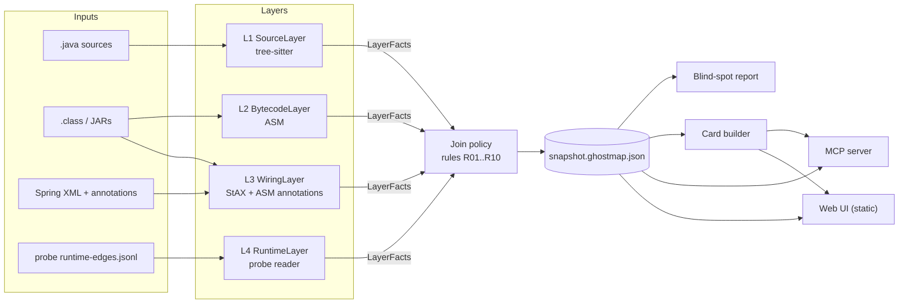
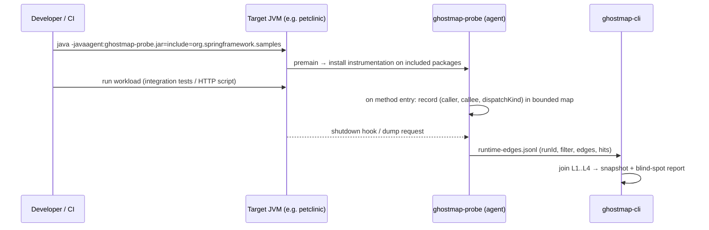
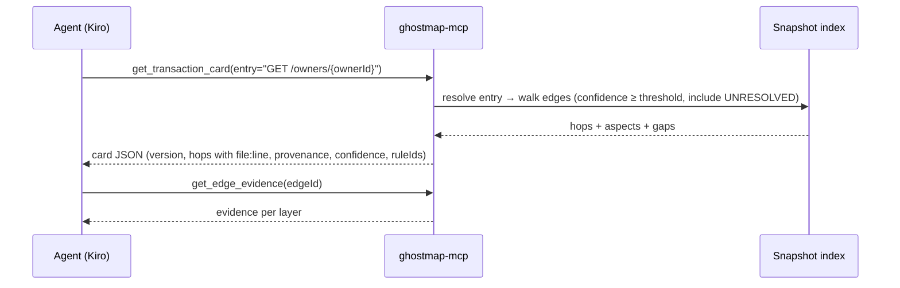

# Design Document — Ghost Map Core

## Overview
Four independent **layers** each turn one kind of input into `LayerFacts`. A single **join policy** merges them
into a **snapshot** (the graph), scores every edge, and emits unresolved/phantom edges and a blind-spot report.
**Cards**, the **MCP server** and the **web UI** are read-only consumers of snapshots.

Design principles: layers are isolated (no layer imports another); all merging/scoring happens in one place;
everything is deterministic and versioned; uncertainty is data, not an absence of data.

## Architecture



### Runtime probe flow



### Agent query flow



## Components and interfaces

```java
sealed interface Layer permits SourceLayer, BytecodeLayer, WiringLayer, RuntimeLayer {
  LayerId id();                      // AST | BYTECODE | WIRING | RUNTIME
  LayerFacts analyse(LayerInput in); // pure w.r.t. inputs; no global state
}
record LayerFacts(LayerId layer, List<Node> nodes, List<EdgeFact> edges, List<Diagnostic> diagnostics) {}
interface JoinRule { String id(); void apply(JoinContext ctx); }   // ordered, see §Join policy
```

- **SourceLayer** — tree-sitter queries for type/method/field declarations, invocations, annotations, string
  literals at dynamic-dispatch sites. Receiver typing is best-effort (local vars, fields, params, imports); the
  baseline "AST-only" mode uses exactly this layer.
- **BytecodeLayer** — ASM `ClassReader` with `SKIP_FRAMES`; emits members, `invoke*` edges with
  owner/name/descriptor and line, hierarchy, annotations, `generated` flags; detects dynamic-dispatch call sites
  (`BeanFactory.getBean`, `Method.invoke`, `Class.forName`, `MethodHandle`, `Map.get` on registry fields — see R07).
- **WiringLayer** — StAX parse of `<beans>`; resolves `parent`, `ref`, `property`, `constructor-arg`, inner beans,
  aliases, `import resource`; component scan by stereotype annotations read via ASM; autowiring by type with
  `@Qualifier`/`@Primary`; `@Bean` factory methods. Emits bean nodes, `INJECTS`, `BINDS`, and UNRESOLVED injection.
- **RuntimeLayer** — reads probe JSONL; maps JVM method signatures to canonical node ids.
- **Probe** — Byte Buddy `AgentBuilder` with include/exclude matchers; advice records the callee and reads the
  caller from a thread-local shadow stack (fallback: `StackWalker` sampling). Bounded `ConcurrentHashMap`; flush on
  shutdown hook or a local trigger file. Overhead target: documented, measured, not promised.

## Data model

### Node identity
Canonical ids are derived from JVM names so that all layers agree:

| Kind | Id format | Example |
|---|---|---|
| TYPE | `t:<binary name>` | `t:org.springframework.samples.petclinic.owner.OwnerController` |
| METHOD | `m:<binary owner>#<name><descriptor>` | `m:…OwnerController#showOwner(I)Lorg/springframework/web/servlet/ModelAndView;` |
| FIELD | `f:<owner>#<name>:<descriptor>` | `f:…OwnerController#owners:L…/OwnerRepository;` |
| BEAN | `b:<context file or "annotations">#<bean id>` | `b:business-config.xml#clinicService` |
| ENTRY | `e:<kind>:<route or trigger>` | `e:http:GET /owners/{ownerId}` |
| EXTERNAL | `x:<kind>:<target>` | `x:jdbc:owners`, `x:http:api.example.org` |
| SITE | `s:<method id>@<bytecode offset>` | dynamic-dispatch call site |

L1 nodes are mapped to these ids via source-to-binary name resolution (package + nesting) and parameter type
erasure; when L1 cannot compute a descriptor, it emits a *provisional* id that R01 reconciles by
(owner, name, arity, line range).

### Snapshot schema (abridged)

```json
{
  "schema": "ghostmap.snapshot/v1",
  "snapshotId": "sha256:…",
  "codeVersion": { "repo": "https://github.com/…", "commit": "abc123", "dirty": false,
                   "classHash": "sha256:…", "analysedAt": "2026-11-20T10:00:00Z" },
  "tool": { "name": "ghostmap", "version": "0.1.0", "joinPolicy": "jp/v1" },
  "layersRun": ["AST", "BYTECODE", "WIRING", "RUNTIME"],
  "runtimeRuns": [{ "runId": "…", "workload": "petclinic-it", "filter": ["org.springframework.samples"] }],
  "nodes": [ { "id": "m:…", "kind": "METHOD", "name": "showOwner", "owner": "t:…",
               "attrs": { "annotations": ["GetMapping"], "generated": false, "role": "CONTROLLER" },
               "loc": { "file": "src/main/java/…/OwnerController.java", "line": 151, "endLine": 158 } } ],
  "edges": [ /* see Edge */ ],
  "report": { /* see Blind-spot report */ }
}
```

### Edge

```json
{
  "id": "sha256(kind|from|to|siteId)",
  "kind": "CALLS | INJECTS | BINDS | EXTENDS | IMPLEMENTS | OVERRIDES | READS_CONFIG | ACCESSES | UNRESOLVED | PHANTOM",
  "from": "m:…", "to": "m:… | b:… | x:… | null (UNRESOLVED)",
  "site": "s:…@42",
  "provenance": ["AST", "BYTECODE", "WIRING", "RUNTIME"],
  "confidence": 0.97,
  "rules": ["R02", "R04", "R06"],
  "evidence": [
    { "layer": "AST", "file": "…/OwnerController.java", "line": 154, "text": "this.owners.findById(ownerId)" },
    { "layer": "BYTECODE", "class": "…/OwnerController.class", "offset": 17, "insn": "invokeinterface",
      "owner": "…/OwnerRepository", "name": "findById", "desc": "(Ljava/lang/Integer;)Ljava/util/Optional;" },
    { "layer": "WIRING", "file": "business-config.xml", "line": 31, "bean": "b:…#ownerRepository" },
    { "layer": "RUNTIME", "runId": "…", "hits": 12 }
  ],
  "dispatch": "STATIC | VIRTUAL | INTERFACE | DYNAMIC | REFLECTION | PROXY | LAMBDA | REGISTRY",
  "candidates": ["m:…"],
  "status": "CONFIRMED | PREDICTED | CANDIDATE | UNRESOLVED | PHANTOM"
}
```

Status meanings: **CONFIRMED** = static and runtime agree; **PREDICTED** = static only (bytecode-exact or
wiring-narrowed), not yet exercised; **CANDIDATE** = one of several possible virtual targets; **UNRESOLVED** =
dynamic site, target unknown; **PHANTOM** = runtime only.

### Confidence algebra
Each evidence item contributes a weight `w ∈ [0,1)`; edge confidence is the noisy-OR

    confidence = 1 − Π (1 − wᵢ)

which is order-independent and **monotone** (adding evidence never lowers confidence — Requirement 5.8).
Initial weights (tunable, calibrated on the haunted-house ground truth, recorded in `joinPolicy` version):

| Evidence | w |
|---|---|
| AST call, receiver type unresolved (name match only) | 0.30 |
| AST call, receiver type resolved | 0.55 |
| BYTECODE exact `invokestatic` / `invokespecial` | 0.90 |
| BYTECODE `invokevirtual`/`invokeinterface`, single implementation in scope | 0.85 |
| BYTECODE virtual, k candidates, no wiring | 0.85 / k (per candidate) |
| WIRING selects this implementation for the receiver bean | 0.80 |
| RUNTIME observed (≥1 hit) | 0.99 |

Penalties are applied to a weight *before* combination (e.g. stale build → AST weights × 0.5), never after, so
monotonicity holds.

## Join policy
Rules run in fixed order; each rule is a pure function over the `JoinContext` and is property-tested.

| Id | Rule | Effect |
|---|---|---|
| R01 Identity | Merge nodes across layers by canonical id; reconcile provisional L1 ids by (owner, name, arity, line range). | One node per JVM member. Ambiguous reconciliation → diagnostic, no merge. |
| R02 Call match | Match an AST call site to a bytecode `invoke*` in the same method by (line, name, arity). | Shared edge with both evidences; unmatched AST calls stay AST-only. |
| R03 Generated members | Bytecode members with no source declaration (Lombok, records, bridges) become nodes with `generated=true`; AST call sites to them are matched via R02. | Fixes the classic Lombok blind spot. |
| R04 Virtual expansion | For `invokevirtual/interface`, expand to overriding implementations in the analysed scope (`CANDIDATE`). | k candidate edges with split weight. |
| R05 Wiring narrowing | If the receiver is a field/ctor param injected from a resolved bean, keep the candidate whose type is the bean's class (incl. `parent` inheritance) and add WIRING evidence. | CANDIDATE → PREDICTED for the wired impl. |
| R06 Runtime floor | An edge matched by a runtime pair gets RUNTIME evidence. | PREDICTED/CANDIDATE → CONFIRMED. |
| R07 Dynamic sites | Calls to dynamic-dispatch APIs become `UNRESOLVED` edges from a SITE node. If the key is a compile-time constant (`getBean("ownerService")`, constant map key) resolve via the wiring/registry index and emit PREDICTED with the site as evidence. | Ghosts are explicit; constant keys get resolved. |
| R08 Phantoms | Runtime pairs with no static edge become `PHANTOM` edges; attach to an UNRESOLVED site in the caller when the dispatch kind matches. | Measured blind spot; "the ghost was here". |
| R09 Conflicts | Source/bytecode disagreement (member in AST but not in bytecode, line drift) → stale-build diagnostic and AST weight penalty. | Never silently trust a stale build. |
| R10 Roles & aspects | Classify nodes (ENTRY, CONTROLLER, SERVICE, DAO, EXTERNAL, CONFIG) from annotations, bean roles, naming of *framework* types (e.g. `JdbcTemplate`, `EntityManager`, `RestTemplate`), and attach aspects (external call, config read, `@Transactional`, branch count). | Feeds cards. |

Properties tested with jqwik (non-exhaustive):
- **Order independence:** join(shuffle(facts)) == join(facts).
- **Monotonicity:** adding any evidence item never decreases any edge's confidence.
- **Bounds:** 0 ≤ confidence < 1 for non-runtime edges; runtime edges ≥ 0.99.
- **Conservation:** every runtime pair ends up in exactly one CONFIRMED or PHANTOM edge.
- **No silent drops:** every dynamic-dispatch site produces either a resolved edge or an UNRESOLVED edge.
- **Idempotence:** join(join(x)) == join(x) for snapshots re-fed as facts.
- **Id round-trip:** parse(format(id)) == id for generated JVM names (incl. inner/anonymous classes, generics erased).

## Blind-spot report

```json
{
  "edgesByProvenance": { "AST": 0, "AST+BYTECODE": 0, "AST+BYTECODE+WIRING+RUNTIME": 0, "RUNTIME": 0 },
  "unresolvedSites": { "GETBEAN": 0, "REFLECTION": 0, "REGISTRY": 0, "PROXY": 0, "OTHER": 0 },
  "phantomEdges": 0,
  "exercised": { "methodsExercised": 0, "methodsInScope": 0 },
  "staticRecallOnExercised": { "astOnly": null, "ghostMap": null },
  "caveat": "Recall is measured only over code exercised by the recorded workloads."
}
```

## Transaction card

### Card JSON schema (draft 2020-12)

```json
{
  "$schema": "https://json-schema.org/draft/2020-12/schema",
  "$id": "https://ghostmap.dev/schema/card/v1.json",
  "title": "Ghost Map transaction card",
  "type": "object",
  "required": ["schema", "cardId", "entry", "codeVersion", "snapshotId", "hops", "gaps", "summary"],
  "properties": {
    "schema": { "const": "ghostmap.card/v1" },
    "cardId": { "type": "string" },
    "snapshotId": { "type": "string" },
    "codeVersion": {
      "type": "object", "required": ["commit", "dirty", "classHash"],
      "properties": { "repo": {"type": "string"}, "commit": {"type": "string"},
                      "dirty": {"type": "boolean"}, "classHash": {"type": "string"} }
    },
    "entry": {
      "type": "object", "required": ["nodeId", "kind", "trigger"],
      "properties": { "nodeId": {"type": "string"},
                      "kind": {"enum": ["HTTP", "XML_MAPPING", "MAIN", "SCHEDULED", "LISTENER"]},
                      "trigger": {"type": "string", "description": "e.g. GET /owners/{ownerId}"} }
    },
    "hops": {
      "type": "array",
      "items": {
        "type": "object",
        "required": ["seq", "depth", "nodeId", "role", "loc", "viaEdge", "provenance", "confidence"],
        "properties": {
          "seq": {"type": "integer", "minimum": 0},
          "depth": {"type": "integer", "minimum": 0},
          "nodeId": {"type": "string"},
          "role": {"enum": ["ENTRY", "CONTROLLER", "SERVICE", "DAO", "DB", "EXTERNAL", "OTHER"]},
          "loc": { "type": "object", "required": ["file", "line"],
                   "properties": {"file": {"type": "string"}, "line": {"type": "integer"},
                                  "url": {"type": "string", "format": "uri"}} },
          "viaEdge": {"type": ["string", "null"]},
          "provenance": {"type": "array", "items": {"enum": ["AST", "BYTECODE", "WIRING", "RUNTIME"]}},
          "confidence": {"type": "number", "minimum": 0, "maximum": 1},
          "aspects": {
            "type": "array",
            "items": { "type": "object", "required": ["kind", "detail"],
                       "properties": {"kind": {"enum": ["EXTERNAL_CALL", "DB_ACCESS", "CONFIG", "TRANSACTION",
                                                         "BRANCH", "SECURITY", "ASYNC"]},
                                      "detail": {"type": "string"},
                                      "loc": {"type": "object"}} }
          }
        }
      }
    },
    "gaps": {
      "type": "array",
      "items": { "type": "object", "required": ["siteId", "dispatch", "fromNodeId", "loc"],
                 "properties": {"siteId": {"type": "string"}, "dispatch": {"type": "string"},
                                "fromNodeId": {"type": "string"}, "loc": {"type": "object"},
                                "partialKey": {"type": ["string", "null"]},
                                "phantomsObserved": {"type": "array", "items": {"type": "string"}}} }
    },
    "summary": {
      "type": "object",
      "required": ["hopCount", "minConfidence", "touches"],
      "properties": { "hopCount": {"type": "integer"}, "minConfidence": {"type": "number"},
                      "touches": {"type": "array", "items": {"type": "string"},
                                  "description": "DB tables / external endpoints / config keys"} }
    }
  }
}
```

Card construction: BFS from the entry over CALLS/BINDS edges with confidence ≥ `minConfidence` (default 0.5),
stop at EXTERNAL/DB nodes or depth limit; collapse framework-internal frames; always include UNRESOLVED edges
reached as `gaps`. Card property tests: every hop's `viaEdge` exists in the snapshot; `seq` is a valid
topological order; every gap's site lies within a hop's method.

## MCP tools

| Tool | Input | Output |
|---|---|---|
| `ghostmap_status` | — | loaded snapshot id, code version, layers run, report summary |
| `find_symbol` | `query`, `kind?` | matching nodes (ambiguity → candidate list) |
| `get_callees` / `get_callers` | `nodeId`, `minConfidence?`, `depth?` | edges with provenance, confidence, rules, evidence |
| `get_edge_evidence` | `edgeId` | all evidence items per layer + rule trace |
| `list_entrypoints` | `kind?`, `filter?` | entry nodes with triggers |
| `get_transaction_card` | `entry` (node id or trigger) | card JSON (schema above) |
| `list_unresolved` | `nodeId?`, `dispatch?` | ghost sites with partial keys and linked phantoms |
| `blind_spot_report` | — | report JSON |
| `explain_path` | `from`, `to`, `minConfidence?` | highest-confidence path(s) with evidence |
| `who_injects` | `beanOrType` | wiring chain incl. XML `parent` inheritance |

All tools are read-only. Results include `snapshotId` and `codeVersion` so an agent can detect stale maps.

## Web UI ("séance room")
- Three panes: entry list · graph (Cytoscape.js) · card/evidence panel.
- Edge style: solid = static confirmed, dashed = predicted, dotted = candidate, glowing translucent = phantom,
  broken "ghost" stroke = unresolved. Opacity = confidence.
- Toggle **AST-only ↔ Ghost Map** animates in the edges the AST missed (the money shot for the demo).
- Evidence links open the exact line on GitHub for the pinned commit.
- Theme: dark, candle-flicker accents, ectoplasm green for runtime evidence. Reduced-motion respected;
  WCAG AA contrast.

## Error handling
- Parse/read failures are diagnostics on the snapshot, never fatal for the whole run.
- Probe failures must never crash the target app; on internal error the probe disables itself and logs to its own file.
- MCP tools return structured errors (`NOT_FOUND`, `AMBIGUOUS`, `STALE_SNAPSHOT`, `TOO_LARGE`).

## Testing strategy
- jqwik properties for every join rule, confidence algebra and id handling (see list above).
- Golden tests on `fixtures/haunted-house`: hand-written ground-truth edge list
  (`fixtures/haunted-house/ground-truth.json`) covering Lombok, XML `parent` beans, qualifiers, `getBean("name")`,
  reflection, a string-keyed handler registry, an AOP proxy.
- End-to-end: index + probe + join on both petclinic variants in CI; snapshot diff reviewed by hook.
- Benchmark harness in `bench/` reproduces published numbers.

## Benchmark design ("AST-only vs Ghost Map")
- **Baseline:** L1 only, with best-effort receiver typing — representative of tree-sitter repo-map approaches.
  We will not call the baseline "Aider" or "Code-Graph-RAG"; it is our own AST-only mode, described exactly.
- **Ground truth A:** haunted-house hand-labelled edges (precision and recall).
- **Ground truth B:** runtime-observed edges on petclinic under its test suite / a scripted HTTP workload
  (recall on exercised code only).
- **Report:** predicted / missed / unresolved-flagged per approach, broken down by cause (Lombok, interface
  dispatch, XML wiring, dynamic lookup). No extrapolation beyond the measured scope.

## Security & clean room
- Read-only analysis; the indexer never executes target code. Only the probe runs inside a target JVM, by explicit
  user action.
- No proprietary inputs. Fixtures are written in this repo; demo targets are fetched from public repos at pinned commits.
